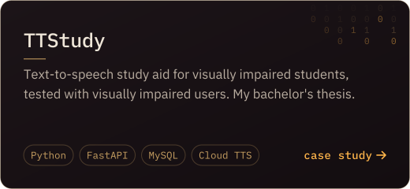
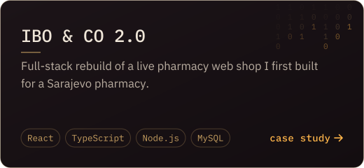
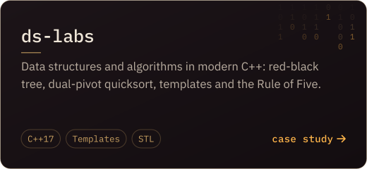
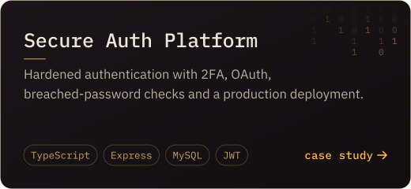
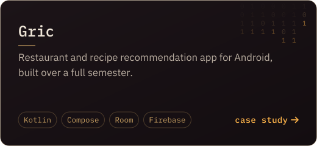
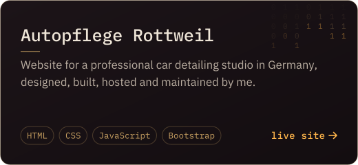

 

&nbsp;
&nbsp;
&nbsp;

 

## Selected work

 

## Tech I work/ed with

   
   
  

 

## Languages

| Bosnian / Croatian / Serbian | English | German | Swedish |
|:---:|:---:|:---:|:---:|
| Native | Fluent | Upper-intermediate | Beginner |

 

## Activity

 

Open to junior and entry-level software engineering roles, internships and freelance projects. 
The fastest way to reach me is the <a href="https://fariskarkelja.github.io/#contact">contact form on my portfolio</a> or <a href="https://www.linkedin.com/in/fariskarkelja/">LinkedIn</a>.

