 

 

 

## Selected work

<table>
<tr>
<td width="50%" valign="top">

### [TTStudy](https://fariskarkelja.github.io/work/ttstudy/)
Text-to-speech study aid for visually impaired students, tested with visually impaired users. My bachelor's thesis.

`Python` `FastAPI` `MySQL` `JavaScript` `Google Cloud TTS`

[Case study](https://fariskarkelja.github.io/work/ttstudy/)

</td>
<td width="50%" valign="top">

### [IBO & CO 2.0](https://fariskarkelja.github.io/work/ibo-co-2/)
Full-stack rebuild of a live pharmacy web shop I first built for a Sarajevo pharmacy.

`React` `TypeScript` `Node.js` `Express` `MySQL` `Vitest`

[Case study](https://fariskarkelja.github.io/work/ibo-co-2/) - [Code](https://github.com/FarisKarkelja/ibo-co-pharmacy)

</td>
</tr>
<tr>
<td width="50%" valign="top">

### [ds-labs](https://fariskarkelja.github.io/work/ds-labs/)
Data structures and algorithms in modern C++: left-leaning red-black tree, dual-pivot quicksort, templates and the Rule of Five.

`C++17` `Templates` `STL`

[Case study](https://fariskarkelja.github.io/work/ds-labs/) - [Code](https://github.com/FarisKarkelja/ds-labs)

</td>
<td width="50%" valign="top">

### [Secure Auth Platform](https://fariskarkelja.github.io/work/secure-auth/)
Hardened authentication system with 2FA, OAuth, breached-password checks and a production deployment.

`TypeScript` `Node.js` `Express` `MySQL` `JWT`

[Case study](https://fariskarkelja.github.io/work/secure-auth/)

</td>
</tr>
<tr>
<td width="50%" valign="top">

### [Gric](https://fariskarkelja.github.io/work/gric/)
Restaurant and recipe recommendation app for Android, built over a full semester.

`Kotlin` `Jetpack Compose` `MVVM` `Room` `Firebase Auth`

[Case study](https://fariskarkelja.github.io/work/gric/) - [Code](https://github.com/FarisKarkelja/mobile-programming)

</td>
<td width="50%" valign="top">

### Client websites
Hand-coded, hosted and maintained for businesses in Germany and Bosnia and Herzegovina.

`HTML` `CSS` `JavaScript` `Bootstrap` `PHP`

[hausmeistercolak.de](https://hausmeistercolak.de/) - [autopflegerottweil.de](https://autopflegerottweil.de/) - [apartmentsmostaria.ba](https://apartmentsmostaria.ba/) - [apotekaiboco.ba](https://apotekaiboco.ba/)

</td>
</tr>
</table>

<a href="https://fariskarkelja.github.io/work/">All projects on my portfolio</a>

 

## Toolkit

   
   
  

 

## Languages

| Bosnian / Croatian / Serbian | English | German | Swedish |
|:---:|:---:|:---:|:---:|
| Native | Fluent | B2 (TestDaF) | A1 |

 

## Activity

 

Open to junior and entry-level software engineering roles, internships and freelance projects. 
The fastest way to reach me is the <a href="https://fariskarkelja.github.io/#contact">contact form on my portfolio</a> or <a href="https://www.linkedin.com/in/fariskarkelja/">LinkedIn</a>.

